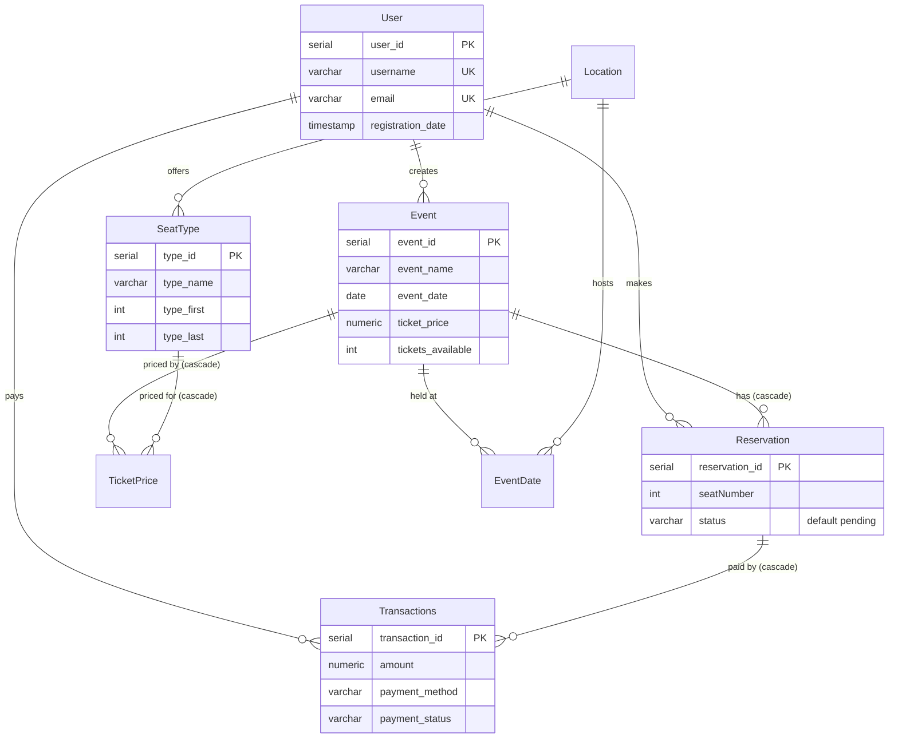
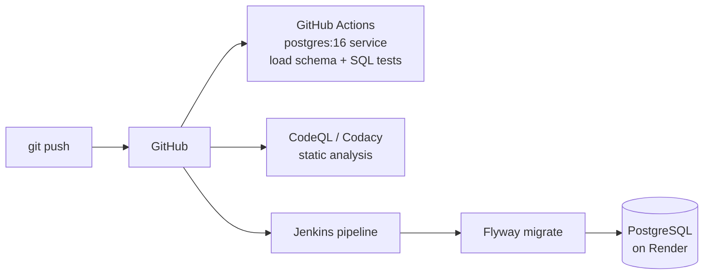

# Event Reservation Database · PostgreSQL + CI/CD

[](https://github.com/MehdiBedja/SGBD/actions/workflows/sql-tests.yml)


The database layer of an event ticketing platform (users, venues, seat types, events, reservations, payments) built for the SGBDA 2024 database course. Business logic lives in **PL/pgSQL functions**, schema changes are versioned with **Flyway**, and a **Jenkins pipeline** deploys migrations to a PostgreSQL instance hosted on **Render**.

## Schema



Indexes cover reservation status, payment status and method, seat-type location and event date.

## Functions

| Function | Purpose |
| --- | --- |
| `create_user`, `update_user`, `get_user_info` | User management |
| `Insert_Location`, `Insert_SeatType`, `Insert_Event`, `Insert_EventDate`, `Insert_TicketPrice` | Catalog management |
| `Insert_Reservation`, `get_reservation_info`, `get_user_reservations` | Reservations |
| `Insert_Transaction`, `get_user_transactions`, `GetUserTotalTransactions`, `get_transaction_details` | Payments |
| `get_user_events` | Events created by a user |
| `CalculateEventRevenue(event_id)` | Sum of payments for an event (0 when none) |
| `get_total_sold_tickets(event_id)` | Number of confirmed reservations |

## CI/CD



## Run locally

```bash
createdb sgbd
psql -d sgbd -v ON_ERROR_STOP=1 -f SGBD_sql.sql
```

Example queries:

```sql
SELECT create_user('alice', '<hash>', 'alice@example.com');
SELECT * FROM get_user_reservations(1);
SELECT CalculateEventRevenue(1);
```

## Tests

`tests/test_functions.sql` exercises every function plus constraints (unique username and email, foreign keys, defaults, `ON DELETE CASCADE`) using PL/pgSQL `ASSERT`. It runs inside a transaction that is rolled back, so it is safe on any database:

```bash
psql -d sgbd -v ON_ERROR_STOP=1 -f tests/test_functions.sql
# → All SQL tests passed
```

## Author

**Mahdi Bedja** · [Portfolio](https://mehdibedja.github.io) · [LinkedIn](https://www.linkedin.com/in/mahdi-bedja-0b94031b3/)
